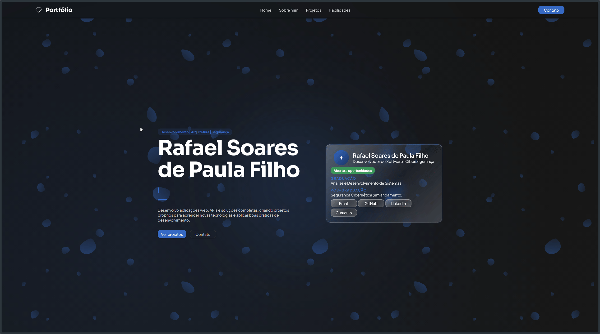

<div align="center">

# Portfolio

**Software developer portfolio: projects, experiments, and continuous learning.**<br>
**Portfólio de desenvolvedor de software: projetos, experimentos e aprendizado contínuo.**

[Site](https://rafaelsoarespf.github.io/portfolio) · [LinkedIn](www.linkedin.com/in/rafael-soares-de-paula-filho) · [Email](mailto:rafaelsoares.p.f.work@gmail.com)

[🇺🇸 English](#english) · [🇧🇷 Português](#portugues)

<br>



</div>

---

<a id="english"></a>

## 🇺🇸 English

### About

Personal portfolio built to showcase software projects, technical experiments, and continuous learning.

It serves as a central place for my work, including web applications, UI experiments, reusable components, and other software development projects. The goal is to demonstrate practical problem-solving, clean architecture, and the technologies I work with while continuously improving my skills.

### Built With

`HTML5` `CSS3` `TypeScript` `Celestial Flow`

The interface is built on **Celestial Flow**, my own CSS framework with a theme-driven architecture: the visual identity lives in a custom theme, so the look can change without touching the structure.

- Semantic HTML with accessible labels and landmarks
- Responsive layout built on the framework's grid
- Animations that respect the reduced-motion preference
- Lazy-loaded project previews
- TypeScript for the page's interactive behavior

### Project structure

```
portfolio/
├── index.html
├── tsconfig.json
├── vendor/
│   └── celestial-flow/
└── src/
    ├── assets/
    ├── styles/
    └── script/
```

### Contact

- **LinkedIn:** [www.linkedin.com/in/rafael-soares-de-paula-filho](www.linkedin.com/in/rafael-soares-de-paula-filho)
- **GitHub:** [https://github.com/rafaelsoarespf](https://github.com/rafaelsoarespf)
- **Email:** [rafaelsoares.p.f.work@gmail.com](mailto:rafaelsoares.p.f.work@gmail.com)

<div align="center">
<sub>© 2026 Rafael Soares de Paula Filho - All rights reserved.</sub>
</div>

---

<a id="portugues"></a>

## 🇧🇷 Português

### Sobre

Portfólio pessoal criado para apresentar projetos de software, experimentos técnicos e aprendizado contínuo.

Ele funciona como um ponto central do meu trabalho, reunindo aplicações web, experimentos de interface, componentes reutilizáveis e outros projetos de desenvolvimento de software. O objetivo é demonstrar resolução prática de problemas, arquitetura limpa e as tecnologias com as quais trabalho, enquanto sigo aprimorando minhas habilidades.

### Tecnologias

`HTML5` `CSS3` `TypeScript` `Celestial Flow`

A interface é construída com o **Celestial Flow**, meu próprio framework CSS de arquitetura orientada a temas: a identidade visual fica em um tema próprio, então o visual pode mudar sem alterar a estrutura.

- HTML semântico com rótulos e regiões de página acessíveis
- Layout responsivo construído sobre o grid do framework
- Animações que respeitam a preferência por movimento reduzido
- Prévias dos projetos com carregamento sob demanda (lazy loading)
- TypeScript para o comportamento interativo da página

### Estrutura do projeto

```
portfolio/
├── index.html
├── tsconfig.json
├── vendor/
│   └── celestial-flow/
└── src/
    ├── assets/
    ├── styles/
    └── script/
```

### Contato

- **LinkedIn:** [www.linkedin.com/in/rafael-soares-de-paula-filho](www.linkedin.com/in/rafael-soares-de-paula-filho)
- **GitHub:** [https://github.com/rafaelsoarespf](https://github.com/rafaelsoarespf)
- **Email:** [rafaelsoares.p.f.work@gmail.com](mailto:rafaelsoares.p.f.work@gmail.com)

<div align="center">
<sub>© 2026 Rafael Soares de Paula Filho - Todos os direitos reservados.</sub>
</div>